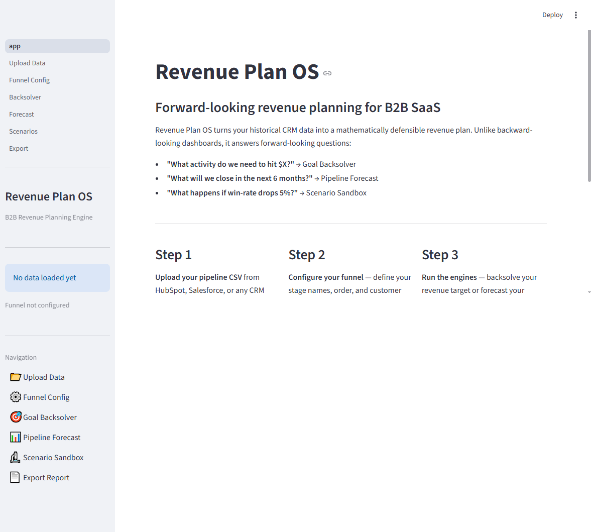

# Revenue Plan OS

A B2B revenue planning and forecasting engine 
for SaaS founders and revenue leaders at $1M–$50M ARR. 


---
## About Revenue Plan OS 
 
A tool for B2B SaaS leaders with ARR between $1M and $50M.
Upload a CRM pipeline CSV, normalize messy stage data with GPT-4o-mini, then run a MILP-based goal backsolver and Monte Carlo pipeline forecast to answer the questions that matter before the quarter starts.

---
## Revenue Plan OS Overview

from docs/screenshots/rpos01_home.png

---

## The Problem It Solves

Most B2B revenue teams operate off backward-looking dashboards. They know what happened last quarter but cannot answer:

- "What activity do we need this month to hit $X in 90 days?"
- "Given what's in the pipeline today, what will we actually close?"
- "If our SQL-to-Won rate drops 5%, how bad does it get?"

Revenue Plan OS answers those three questions from a single CSV export.

---

## Core Features

- **Goal-to-Activity Backsolver** — enter a revenue target; the MILP engine (PuLP/CBC) returns the optimal channel mix and minimum spend required, accounting for channel-level capacity constraints and diminishing returns curves.
- **Monte Carlo Pipeline Forecast** — 10,000 simulation paths across every entity currently in the funnel. Output is always a confidence band (P5/P50/P95), never a point estimate.
- **Scenario Sandbox** — adjust conversion rates and velocity via sliders; compare up to N scenarios side-by-side in a single results table.
- **LLM Stage Normalizer** — GPT-4o-mini maps dirty CRM stage values ("Proposal Sent", "In Negotiation", "Trial Active") to your canonical funnel stages. Falls back to a manual mapping UI when no API key is configured.
- **Cohorted Conversion Matrix** — the shared computation backbone. All conversion rates are cohort-based (grouped by entry month) rather than point-in-time snapshots. Backsolver and forecast both read from the same precomputed view.
- **Data Quality Gates** — every analysis page checks `check_data_sufficiency()` before running. Displays "Not enough data" with an explanation rather than silently returning misleading numbers.
- **Export** — generates a board-ready PDF (ReportLab) or PPTX (python-pptx) narrative report from forecast and backsolver results.

---

## Live Demo , Features, and Bugs
[Live Demo Link ](Link Coming Soon)

[Report Bug](Link Coming Soon) · 

[Request Feature](Link Coming Soon)

---
## Tech Stack

| Layer | Technology |
|---|---|
| UI | Streamlit (Python) |
| Data layer | DuckDB (in-memory) + Pandas |
| Optimization | PuLP (MILP, CBC solver) |
| Simulation | NumPy (10,000-path Monte Carlo) |
| AI | OpenAI API (gpt-4o-mini) |
| Visualization | Plotly |
| Export | ReportLab (PDF), python-pptx (PPTX) |
| Tests | pytest (85+ tests) |

---

## Architecture

All features share a single DuckDB schema built around an account-centric, event-stream model:

- `dim_account` is the anchor entity — every metric traces back to an account, not a lead or contact.
- `fact_stage_event` is append-only. Conversion rates are always cohort-based, never point-in-time.
- `view_cohorted_conversion_matrix` is the shared backbone. Backsolver and forecast read from here; neither engine reaches into raw fact tables independently.
- Schemas map 1:1 to Snowflake/BigQuery for a future warehouse-native migration (Phase 2/3).

---
## Prerequisites
- Python 3.11+

---

## Installation

```bash
pip install -e ".[dev]"
```
This installs Streamlit, DuckDB, PuLP, NumPy, Plotly, OpenAI, ReportLab, python-pptx, and all dev dependencies in one step.

---

## Screenshots

See `docs/SCREENSHOT_INDEX.md` for the index.

---

## Known Limitations

- **Session-scoped data** — the DuckDB connection is in-memory and tied to the Streamlit session. Refreshing the browser resets the data state. There is no persistent storage in Phase 1.
- **Small-N sensitivity** — cohort-based rates can be noisy when monthly cohorts are small. The system flags low-confidence transitions but does not prevent users from running the engines on thin data.
- **Outbound entry stage is hardcoded** — the `OUTBOUND_ENTRY_STAGE = "SQL"` constant in `config.py` cannot be changed from the UI. Requires a code edit.
- **No live CRM connections** — Phase 1 is CSV-only. Salesforce/HubSpot OAuth sync is Phase 2.
- **Export charts are text-only** — PDF and PPTX exports contain narrative text but not the Plotly chart images (kaleido integration is not implemented).

---

## Future Direction

See `ROADMAP.md` for the full phased plan.
See `PROJECT_SUMMARY.md` for a detailed architectural overview.

---

## License
Copyright © M. Kyle Craig. All rights reserved.

This repository and its contents are made publicly visible solely for review and evaluation purposes. 
No permission is granted to copy, distribute, modify, or create derivative works from this software for commercial or non-commercial purposes without explicit written consent from the author.
